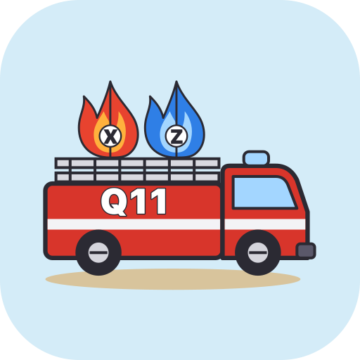
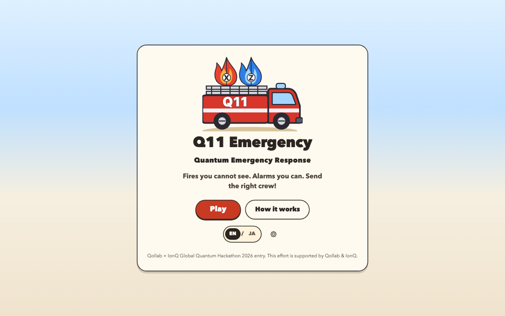
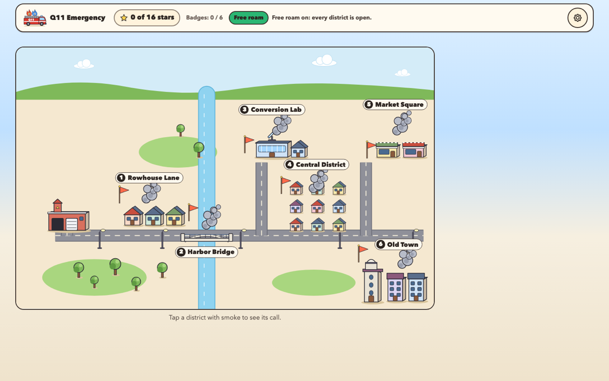
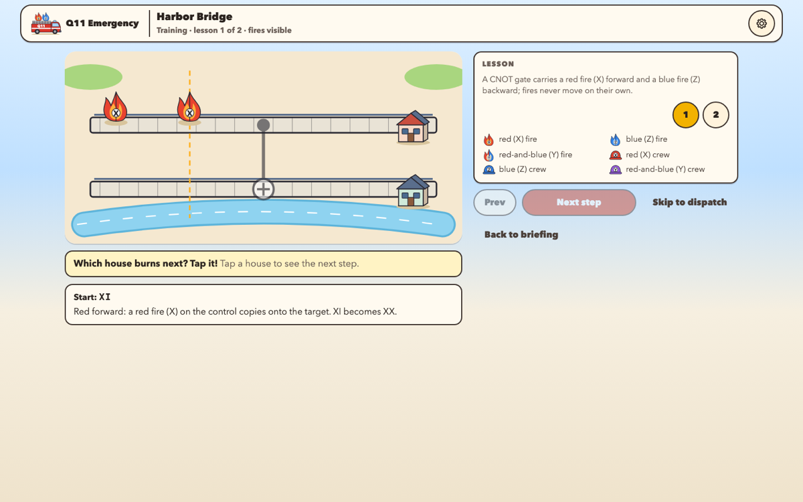
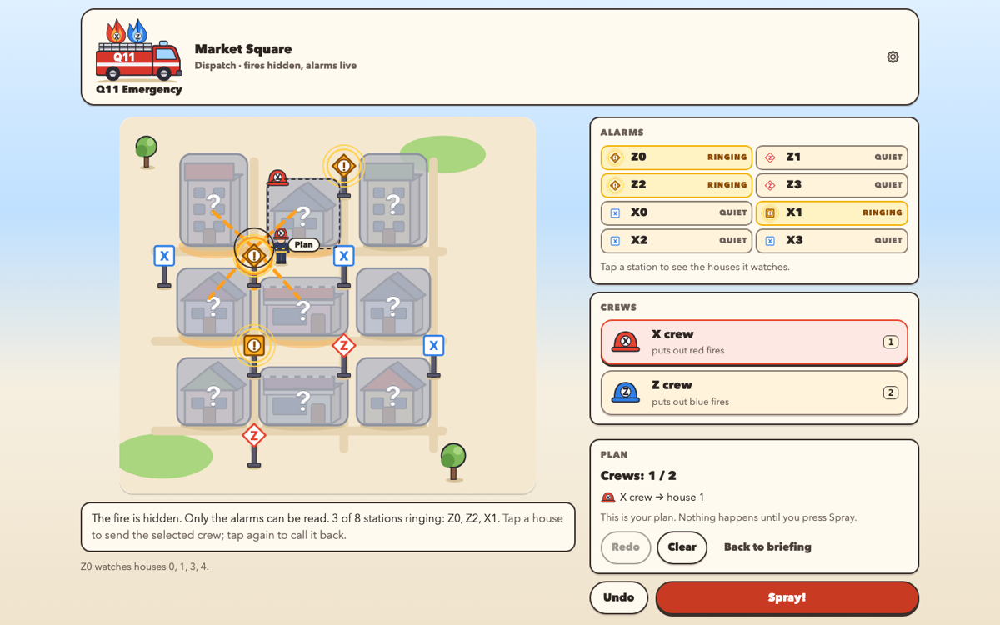
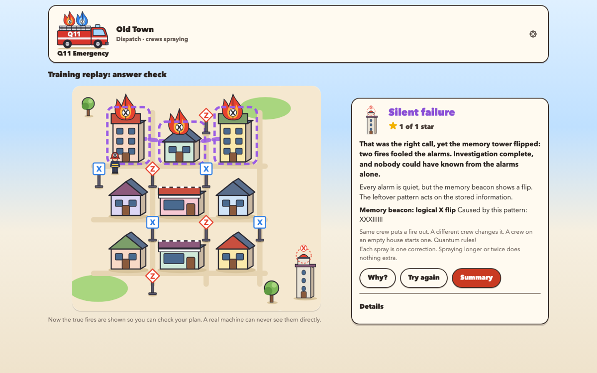
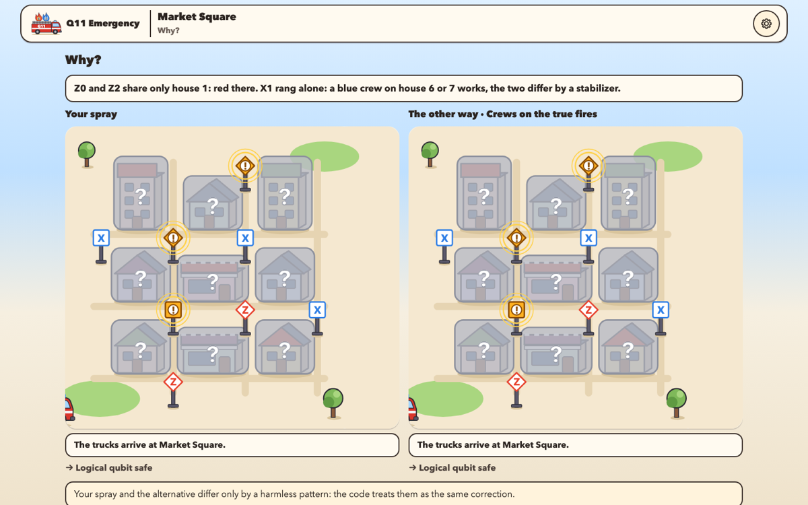

<p align="center">
  
</p>

<h1 align="center">Q11 Emergency</h1>
<p align="center"><strong>Quantum Emergency Response</strong> — a fire-dispatch game that teaches how quantum error correction reasons.</p>

<p align="center">
  <a href="https://qollab.xyz/u/doraking/q11-emergency">Play on Qollab</a> ·
  <a href="https://q11-emergency.vercel.app">Play on the web</a> ·
  <a href="https://www.youtube.com/watch?v=caRB8CaDgBE">Demo video (2:54)</a> ·
  <a href="LICENSE">MIT License</a>
</p>

Built for the **Qollab × IonQ Global Quantum Hackathon 2026** (theme: *Quantum Unlocked*). **This effort is supported by Qollab & IonQ.**

You are the dispatcher of a toy quantum city. Houses are qubits. An arsonist called *Noise* lights **red fires (X errors)** and **blue fires (Z errors)**. You never see the fires in the field: you only hear the **alarm stations** (stabilizer checks), send **crews** (Pauli corrections), press **Spray!** and find out whether the city is safe, or whether a perfect-looking call silently flipped the logical qubit. Available in English and Japanese.

<p align="center"></p>

## How the game maps to quantum error correction

| In the city | In the physics |
|---|---|
| House | Data qubit |
| Red fire / blue fire / split fire | *X* / *Z* / *Y* Pauli error |
| Alarm station (rings or stays quiet) | Stabilizer check: rings when the error **anticommutes** with it |
| Red crew / blue crew | *X* / *Z* correction applied to one qubit (composition is XOR, *X*·*X* = *I*: a crew on a burning house puts it out, a crew on a safe house starts a fire) |
| Fog over the houses | The error is hidden; only the syndrome is observable |
| Spray! → answer check | Residual *R* = *C*·*E* evaluated over 𝔽₂ |
| Houses restored / harmless pattern | *R* = *I* / *R* ∈ 𝒮 (a stabilizer): logical information safe |
| Fires still burning | *R* anticommutes with a check: detectable |
| Memory tower flips, every alarm quiet | *R* ∈ N(𝒮) ∖ 𝒮 (commutes with every check, not a stabilizer): **logical error** |
| Fire truck driving through gates | Pauli frame propagation: *H* swaps *X* ↔ *Z*, CNOT copies *X* forward and *Z* backward |

## A tour

**1. The city map.** Six districts, six lessons, unlocked in order (a *Free roam* setting opens everything). Tap a district with smoke, press *Dispatch!*, and the fire truck drives you there.

<p align="center"></p>

**2. Training: fires are visible.** In the propagation districts you step a fire through a small circuit and predict where it goes next: a CNOT copies a red fire *forward* and a blue fire *backward*; a Hadamard swaps the colours.

<p align="center"></p>

**3. Dispatch: fires are hidden.** On the distance-3 rotated surface code (9 houses, 8 stations) you read which stations ring, tap a station to see the houses it watches, place crews within a budget (undo/redo), and press *Spray!*. Nothing on screen reads the hidden error before you commit.

<p align="center"></p>

**4. Answer check.** The crews run in, each hose applies exactly one Pauli correction computed by the engine, the fog lifts, and one of four results appears. Below: *Silent Failure* in Old Town, the minimum-weight call that silences every alarm and still flips the memory tower.

<p align="center"></p>

**5. Why?** Your spray and the alternative correction (minimum-weight decoder, or crews on the true fires) replay side by side on the same board, with the step-by-step residual under *Details*.

<p align="center"></p>

## Missions

| # | District | Mission | What it teaches |
|---|---|---|---|
| 1 | Rowhouse Lane | **First Alarm** | 3-qubit repetition code, X noise only: two alarms, one crew |
| 2 | Harbor Bridge | **Red Forward / Blue Backward** | CNOT: X copies control→target, Z copies target→control |
| 3 | Conversion Lab | **Color Switch** | Hadamard swaps red and blue; chained with a CNOT |
| 4 | Central District | **Blind Dispatch** | distance-3 rotated surface code, one hidden fire, alarms only |
| 5 | Market Square | **Two Kinds of Trouble** | X and Z alarms at once; one X crew and one Z crew |
| 6 | Old Town | **Silent Failure** | two fires, one alarm: the optimal call flips the logical qubit |

The first run is a three-tap guided scene. Everything works by tapping; keyboard and screen readers are supported; shapes and X/Z/Y letters carry every meaning so colour is never required; reduced motion plays the same causality as static frames.

## Qiskit, Qollab and IonQ

The Qollab project is a **JS/Qiskit** page: the game itself plus a pure-Python Qiskit package (`qollab/q11/*.py`) that builds encode → inject → syndrome-extraction → correct → readout circuits for every mission. Press *Run* on Qollab, pick a backend in *Select QPU*, and the page runs a self-test (Blind Dispatch, 100 shots) on that backend and prints the measured syndrome and logical statistics next to the Pauli-frame prediction; any surface-code result can then be verified as a circuit from *Details → Verify on this backend*.

- Built-in ideal simulator: the measured distribution matches the prediction exactly.
- IonQ Aria 1 free noise-model simulator: counts deviate statistically and the page says so. Recorded jobs, histograms and raw counts: [`reports/qollab-runs.md`](reports/qollab-runs.md), [`reports/qollab-runs/`](reports/qollab-runs/).
- **No hardware (QPU) runs were made, and none are claimed.**

## The science

An $n$-qubit Pauli error (up to phase) is a binary symplectic vector $P = (x, z) \in \mathbb{F}_2^{n} \times \mathbb{F}_2^{n}$. Composing errors and corrections is XOR, and two Paulis commute exactly when their symplectic product is zero:

```math
(x, z) \cdot (x', z') = (x \oplus x',\ z \oplus z'), \qquad \langle P, P' \rangle = x \cdot z' + z \cdot x' \bmod 2 .
```

Gates move the frame (fires never move on their own):

```math
H:\ x \leftrightarrow z, \qquad S:\ z \leftarrow z \oplus x, \qquad \mathrm{CNOT}_{c \to t}:\ x_t \leftarrow x_t \oplus x_c,\quad z_c \leftarrow z_c \oplus z_t .
```

A check $S_j$ rings when $\langle E, S_j \rangle = 1$. After the crews apply the correction $C$, the residual $R = C \cdot E$ decides the result by $\mathbb{F}_2$ linear algebra over the stabilizer group $\mathcal{S}$:

```math
\begin{aligned}
R \in \mathcal{S} &\;\Rightarrow\; \text{success} \\
R \in N(\mathcal{S}) \setminus \mathcal{S} &\;\Rightarrow\; \text{logical error (commutes with every check, not a stabilizer)} \\
\langle R, S_j \rangle = 1 \text{ for some } j &\;\Rightarrow\; \text{detectable}
\end{aligned}
```

For the distance-3 rotated surface code the logical operators are $\bar X = X_0 X_1 X_2$ and $\bar Z = Z_0 Z_3 Z_6$; "alarms off" alone is never counted as success. Perfect-syndrome, Clifford + Pauli educational model. Details: [`docs/SCIENCE.md`](docs/SCIENCE.md).

## Run it yourself

```bash
npm ci && npm run dev        # web game at http://localhost:5173
npm run test:unit            # engine + game + UI tests (vitest)
npm run test:e2e             # Playwright: desktop / tablet / phone Chromium + desktop WebKit
npm run verify:quantum       # independent Python/Qiskit comparison (exhaustive gate tables, 28 single-error patterns,
                             # ≥1000 seeded propagation and verdict cases, Aer runs of every mission circuit)
npm run verify:release       # everything above + submission asset checks → reports/release-verification.json
```

Python for the verification scripts: `uv venv --python 3.12 .venv && uv pip install --python .venv/bin/python -r quantum/requirements.txt` (Qiskit 2.5.x, qiskit-aer). Importing the project into your own Qollab account: [`submission/QOLLAB_IMPORT.md`](submission/QOLLAB_IMPORT.md).

## Repository layout

```
src/quantum   Pauli frames, codes, GF(2), verdicts, decoder        quantum/   Python/Qiskit reference + comparison
src/game      missions, state machine, scoring, replay, storage   qollab/    Qollab-native project (JS page + Python Qiskit modules)
src/ui        React UI: city map, scene art, spray effects, EN/JA fixtures/  shared mission + verification JSON
public/       original icon set                                   scripts/   verification, icons, demo recording
submission/   project page, demo script, checklist, evidence      reports/   test and verification outputs (no secrets)
docs/         plan, status, decisions, science, images            spec/      build specification
```

## Limitations

Clifford + Pauli educational model, perfect syndromes, distance 3, no measurement noise or repeated rounds, no QPU runs, no claims of quantum advantage. Full list: [`submission/KNOWN_LIMITATIONS.md`](submission/KNOWN_LIMITATIONS.md).

## Credits

Design and implementation: Tomoya Hatanaka ([@dorakingx](https://github.com/dorakingx)), built during the hackathon window with AI assistance (Claude Code), disclosed in [`submission/ATTRIBUTION.md`](submission/ATTRIBUTION.md). Libraries: React, Vite (MIT); Qiskit, qiskit-aer (Apache-2.0). All art is original SVG. Status and publication record: [`docs/STATUS.md`](docs/STATUS.md).
